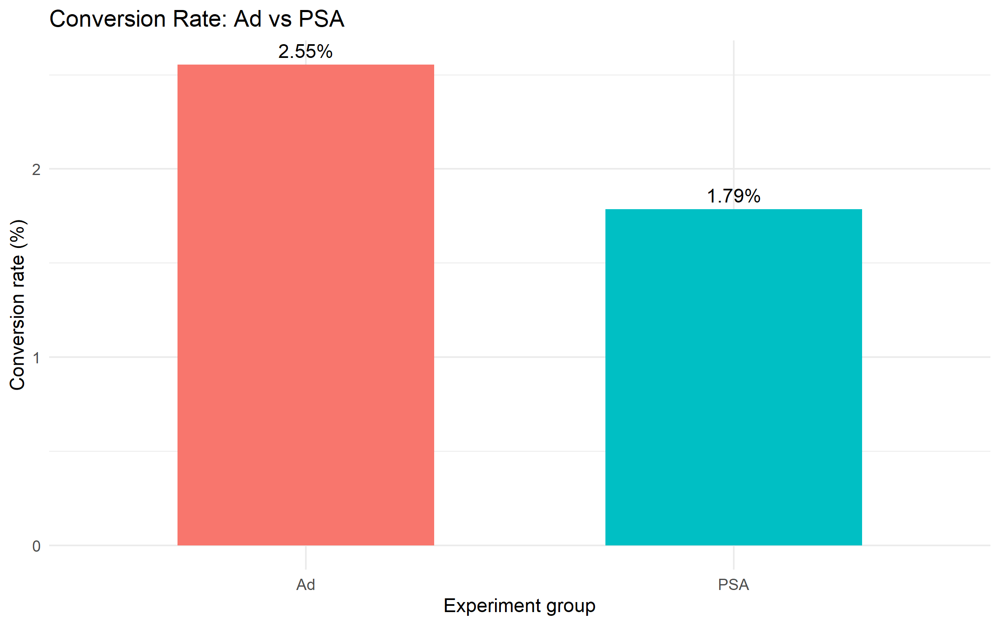
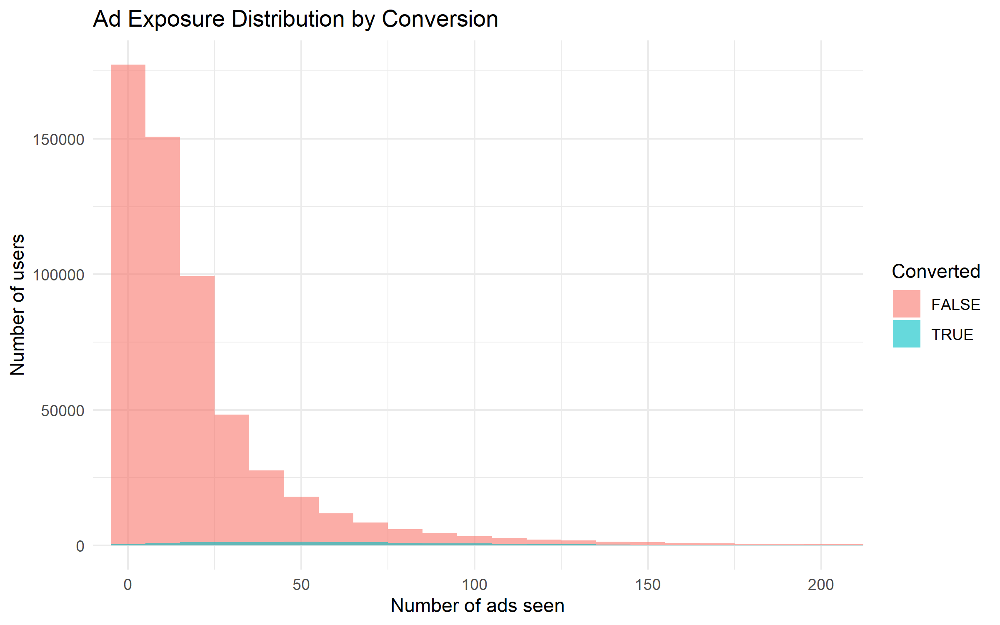

# Marketing A/B Testing in R

A statistical analysis comparing advertisement exposure with a public service announcement (PSA) to evaluate differences in user conversion rates.

## Dataset

- Source: [Marketing A/B Testing — Kaggle](https://www.kaggle.com/datasets/faviovaz/marketing-ab-testing)
- Dataset file: `marketing_AB.csv`
- Ad group: 564,577 users
- PSA group: 23,524 users
- Outcome: Whether a user converted

## Methodology

1. Loaded and cleaned the dataset.
2. Calculated conversion rates for both groups.
3. Performed a two-proportion hypothesis test using `prop.test()`.
4. Calculated absolute conversion difference and relative lift.
5. Computed an approximate 95% confidence interval.
6. Visualized conversion rates and ad exposure distributions.

### Hypotheses

- **Null hypothesis (H₀):** The conversion rates of the ad and PSA groups are equal.
- **Alternative hypothesis (H₁):** The conversion rates differ.

Significance level: \(\alpha = 0.05\)

## Results

| Metric | Result |
|---|---:|
| Ad conversion rate | 2.555% |
| PSA conversion rate | 1.785% |
| Absolute difference | 0.769 percentage points |
| Relative lift vs. PSA | 43.09% |
| 95% confidence interval | 0.595 to 0.943 percentage points |
| P-value | 1.705 × 10⁻¹³ |

## Visualizations

### Conversion Rate Comparison

The ad group had a conversion rate of 2.555%, compared with 1.785% for the PSA group. The observed difference was approximately 0.769 percentage points.

### Ad Exposure Distribution

This visualization explores how the number of advertisements seen varies between users who converted and those who did not.

## Statistical Interpretation

The p-value is far below the 0.05 significance threshold. Therefore, the null hypothesis of equal conversion rates is rejected.

The estimated difference is positive, and the 95% confidence interval excludes zero. The data provide strong statistical evidence of a difference between the observed conversion rates, favoring the ad group.

The relative lift of 43.09% means the ad group's observed conversion rate was approximately 43% higher than the PSA group's rate.

## Limitations

- The groups are highly imbalanced in size.
- Statistical significance does not necessarily imply a large business impact.
- The confidence interval for the difference is an approximate Wald interval.
- Ad exposure patterns may be associated with user behavior and the exposure plot alone cannot establish a causal relationship.

## Conclusion

The ad group showed a statistically higher observed conversion rate than the PSA group in this dataset. This project demonstrates how hypothesis testing, effect-size calculations, and visualizations can support evidence-based marketing analysis. Further verification of the experiment design is needed before attributing the difference directly to advertising.