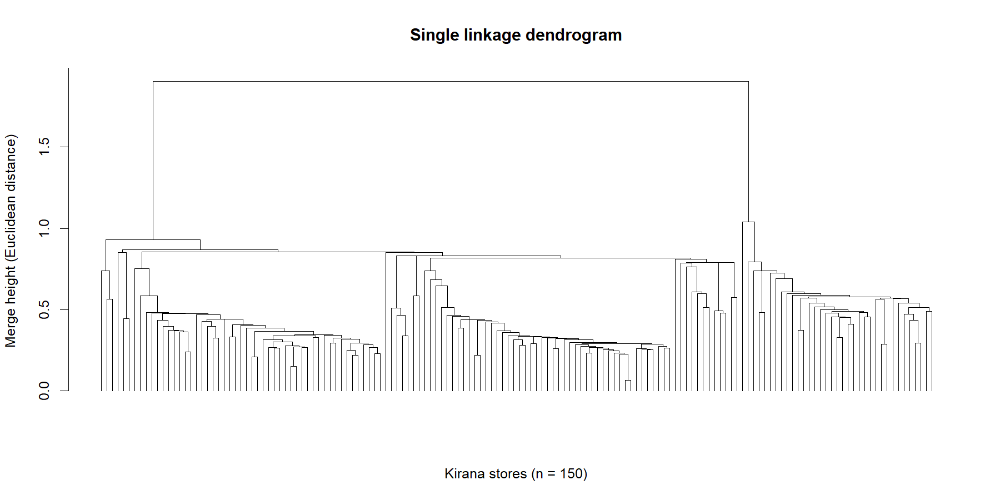
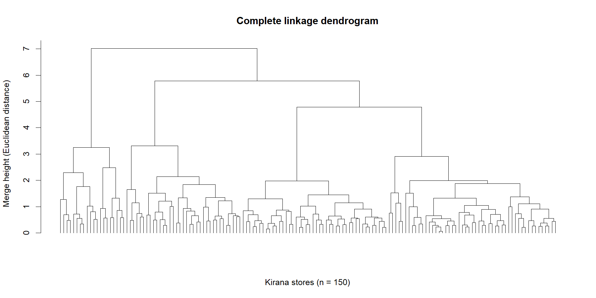
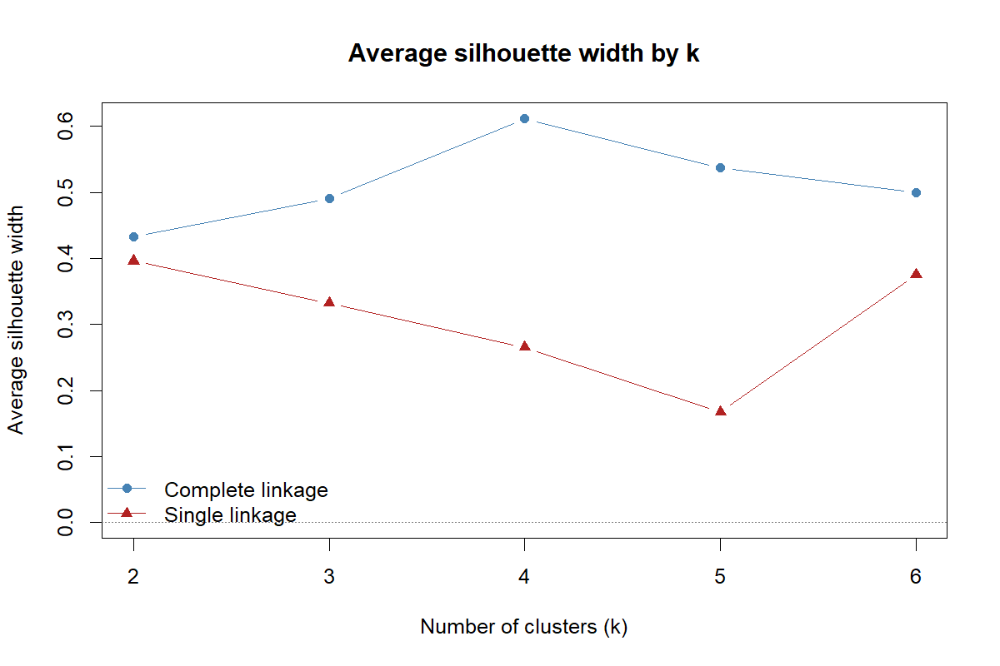
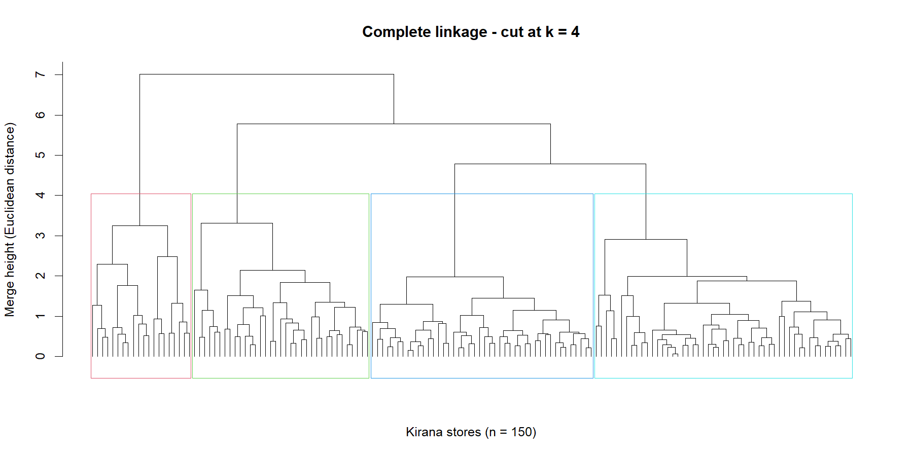
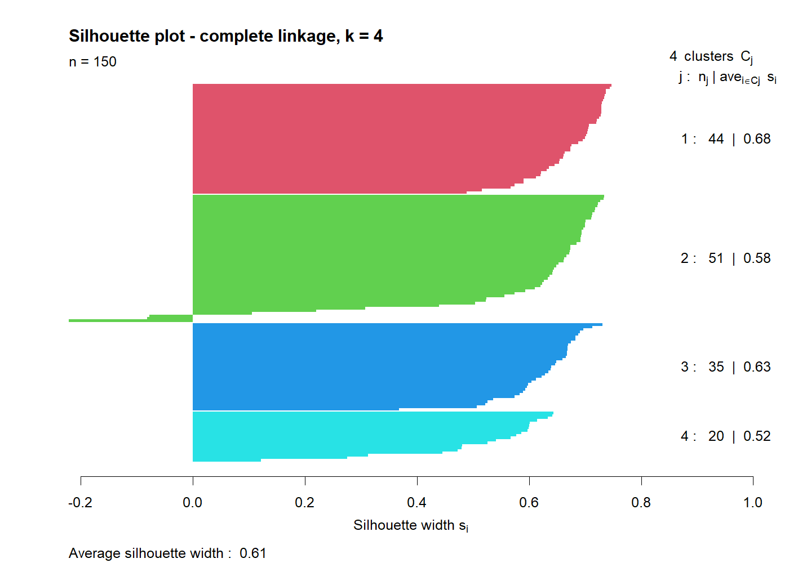
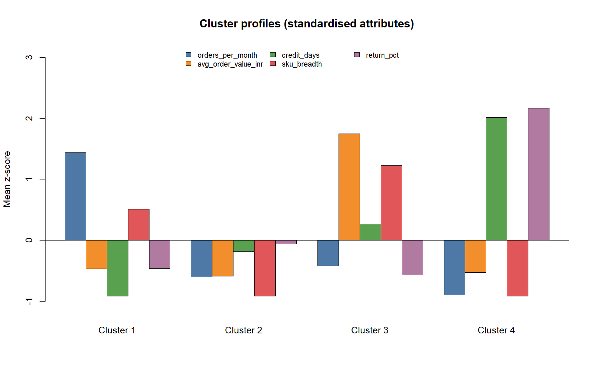

# Business problem
A regional FMCG distributor supplies packaged foods, personal care and household products to about 150 kirana (neighbourhood grocery) stores. Today every store gets the same treatment: the same credit period, the same weekly sales-rep visit and the same trade promotions. That one-size policy is expensive. Reps spend time on stores that order rarely, credit is extended to stores that pay late or return a lot of stock, and large wholesale-type buyers who could absorb bulk schemes are not targeted.

**Business question**: Do the distributor's kirana stores fall into natural groups based on how they order, pay and return goods, and how should credit limits, visit frequency and promotions differ across those groups?

There is no pre-existing label telling the distributor which type each store is, so this is an unsupervised problem. Hierarchical clustering groups stores with similar ordering and payment behaviour, and the dendrogram shows how the groups nest. The distributor can then design 3–5 policies instead of 150 individual ones.

# Clustering attributes
| Attribute | Unit | What it measures | Why it may distinguish groups |
|---|---|---|---|
| `orders_per_month` | orders | Number of orders placed with the distributor per month | Busy urban stores restock often; village shops and struggling stores order rarely. |
| `avg_order_value_inr` | Rs | Average invoice value per order | Wholesale-cum-retail stores place very large orders; small shops place small orders. |
| `credit_days` | days | Average number of days the store takes to pay an invoice | Separates healthy fast payers from stretched or at-risk stores; this drives credit risk. |
| `sku_breadth` | SKUs | Number of distinct products bought | Large stores stock a wide range; small shops stock only fast-moving basics. |
| `return_pct` | % | Share of supplied goods returned as damaged or expired | High returns signal poor stock rotation or a weak store, and add reverse-logistics cost. |

# Dataset

The dataset is kirana_stores.csv with 150 stores and 7 columns: two character identifiers (store_id, beat), four integer attributes and one numeric attribute (return_pct).

It has 6 missing values (unrecorded ledger entries) and 4 invalid values: two negative credit-day values and two return percentages above 100%.

> The project uses a synthetic dataset

| Attribute | Missing (NA) | Invalid | Problem found | Median used to impute |
|---|---:|---:|---|---:|
| orders_per_month | 0 | 0 | None | – |
| avg_order_value_inr | 2 | 0 | Missing values | 5,820 |
| credit_days | 2 | 2 | Values of −4 and −11 (impossible) | 18 |
| sku_breadth | 1 | 0 | Missing value | 72 |
| return_pct | 1 | 2 | Values of 108% and 125% (a share cannot exceed 100%) | 2.3 |

Each attribute was checked against a business rule (e.g. credit_days ≥ 0, 0 ≤ return_pct ≤ 100). Invalid values were first set to NA and then every NA was replaced with that column's median. The median was used rather than the mean because these business variables are skewed (order value ranges from Rs 2,200 to Rs 42,640) and the median is not pulled by extreme values. Only 10 of 750 attribute cells (1.3%) were affected, so imputation keeps all 150 stores without noticeably changing any distribution. Dropping rows would have lost 10 stores, about 7% of the data. After cleaning there are 0 missing values.

# Attribute selection and standardisation
| Statistic | orders_per_month | avg_order_value_inr | credit_days | sku_breadth | return_pct |
|---|---:|---:|---:|---:|---:|
| Mean | 7.13 | 11,568 | 21.63 | 69.09 | 3.56 |
| Std. dev. | 5.34 | 11,836 | 16.18 | 32.53 | 3.32 |
| Range | 1 – 20 | 2,200 – 42,640 | 0 – 76 | 19 – 172 | 0.6 – 15.9 |

Euclidean distance adds up squared differences across attributes. Without scaling, a Rs 1,000 difference in order value would count about a million times more than a 1-day difference in credit days, so the clusters would be driven almost entirely by order value. z-score standardisation, z = (x − mean) / sd using scale(), puts every attribute on a common scale with mean 0 and standard deviation 1. Each attribute then contributes in proportion to how unusual a store is on it, not according to its unit of measurement. The script confirms that every scaled column has mean 0 and sd 1.

# Distance matrix

A 150 × 150 Euclidean distance matrix was calculated on the standardised data with dist(Z, method = "euclidean"). For example, stores KS001 and KS004 (both busy urban stores) are 1.15 apart, while KS001 and KS005 (a wholesale-type store) are 4.01 apart.

# Agglomerative clustering: single and complete linkage
hclust() was run twice on the same distance matrix: method = "single" (the distance between two clusters is the closest pair of stores) and method = "complete" (the farthest pair of stores).

# Choosing the number of clusters

## Dendrogram gaps
The script lists the heights of the last merges in each tree. A large jump between consecutive merge heights is a long vertical gap in the dendrogram, which is a natural place to cut.

| Clusters if cut just below | Single: merge height | Single: gap | Complete: merge height | Complete: gap |
|---|---:|---:|---:|---:|
| k = 2 | 1.906 | 0.865 | 7.019 | 1.234 |
| k = 3 | 1.041 | 0.112 | 5.786 | 1.006 |
| k = 4 | 0.930 | 0.060 | 4.780 | **1.471** |
| k = 5 | 0.870 | 0.014 | 3.309 | 0.062 |
| k = 6 | 0.855 | 0.004 | 3.247 | 0.337 |

- **Single linkage** has only one clear gap (k = 2), which splits off 35 stores from the rest. Below that, merges happen at almost continuous heights. This is the chaining effect typical of single linkage: stores join one at a time through near neighbours, so there is no other natural cut.
- **Complete linkage** has three well-spaced upper merges. The largest gap (1.47) is between heights 4.78 and 3.31, so a cut at about height 4 gives four branches. Below k = 4 the next merges are packed together (gap 0.06).

## Silhouette widths
For each linkage and k = 2 to 6, the tree was cut with cutree() and silhouette() was computed on the same distance matrix.

| Linkage | k | Avg. silhouette width | Cluster sizes | Stores with negative silhouette |
|---|---:|---:|---|---:|
| Single | 2 | 0.396 | 115 / 35 | 0 |
| Single | 3 | 0.332 | 115 / 34 / 1 | 2 |
| Single | 4 | 0.265 | 112 / 34 / 3 / 1 | 23 |
| Single | 5 | 0.167 | 109 / 34 / 3 / 1 / 3 | 32 |
| Single | 6 | 0.375 | 45 / 64 / 34 / 3 / 1 / 3 | 22 |
| Complete | 2 | 0.433 | 130 / 20 | 6 |
| Complete | 3 | 0.491 | 95 / 35 / 20 | 5 |
| **Complete** | **4** | **0.612** | **44 / 51 / 35 / 20** | **3** |
| Complete | 5 | 0.537 | 44 / 51 / 29 / 20 / 6 | 6 |
| Complete | 6 | 0.500 | 44 / 51 / 29 / 12 / 6 / 8 | 7 |

## Final choice: complete linkage, k = 4
- **Linkage.** Single linkage is not usable here. Beyond k = 2 it only splits off one to three stores at a time (112 / 34 / 3 / 1 at k = 4) and up to 32 stores get negative silhouettes. Its best result (k = 2) is just "wholesale vs everyone else", which is too coarse for setting policy. Complete linkage gives compact, balanced groups and has a higher silhouette at every k.
- **Number of clusters.** k = 4 is supported three ways: it is the largest gap in the complete-linkage dendrogram (1.47), it has the highest average silhouette (0.612), and every cluster has a distinct business meaning. k = 5 or 6 only splits the wholesale cluster into small subgroups of 6–12 stores. k = 3 merges busy urban stores with village shops, even though they need very different visit schedules.

# Quality of the chosen solution
For each store, the silhouette s(i) = (b(i) − a(i)) / max(a(i), b(i)), where a(i) is its average distance to stores in its own cluster and b(i) is its average distance to stores in the nearest other cluster. It ranges from −1 to +1: near +1 means the store sits well inside its cluster, near 0 means it is on a boundary and negative means it may be in the wrong cluster.

| Average silhouette width | Interpretation |
|---|---|
| Above 0.70 | Strong structure |
| 0.51 – 0.70 | Reasonable structure |
| 0.26 – 0.50 | Weak structure |
| 0.25 or below | No substantial structure |

The overall average silhouette width is **0.612**, a reasonable structure. All four clusters have positive averages (cluster 1: 0.68, cluster 2: 0.58, cluster 3: 0.63, cluster 4: 0.52). Cluster 4 is the least compact because at-risk stores vary more in how late they pay.

Only 3 of 150 stores (2%) have negative silhouettes. All three are in cluster 2 with cluster 4 as their nearest neighbour:

| Store | Assigned to | Nearest cluster | Silhouette | Credit days | Return % |
|---|---|---|---:|---:|---:|
| KS117 | 2 (Low-Frequency Basic) | 4 (Credit-Risk) | −0.081 | 30 | 9.2 |
| KS143 | 2 (Low-Frequency Basic) | 4 (Credit-Risk) | −0.220 | 31 | 10.1 |
| KS146 | 2 (Low-Frequency Basic) | 4 (Credit-Risk) | −0.077 | 40 | 6.9 |

These stores have return rates typical of the Credit-Risk group, but their credit days sit between the two groups. They are probably early-stage at-risk stores and should be watched.

# Cluster profiles
Means of each attribute by cluster, from the cleaned data in original units:

| Cluster | Stores | Orders / month | Avg order value (Rs) | Credit days | SKU breadth | Return % |
|---|---:|---:|---:|---:|---:|---:|
| 1 | 44 | 14.8 | 5,954 | 6.7 | 85.7 | 2.0 |
| 2 | 51 | 3.9 | 4,629 | 18.7 | 39.0 | 3.4 |
| 3 | 35 | 4.9 | 32,325 | 26.0 | 109.0 | 1.7 |
| 4 | 20 | 2.3 | 5,292 | 54.3 | 39.3 | 10.7 |
| All stores | 150 | 7.1 | 11,568 | 21.6 | 69.1 | 3.6 |

The mean z-scores show which attributes make each cluster distinctive (values above about +1 or below −1 stand out):

| Cluster | orders_per_month | avg_order_value_inr | credit_days | sku_breadth | return_pct |
|---|---:|---:|---:|---:|---:|
| 1 | **1.44** | −0.47 | −0.92 | 0.51 | −0.46 |
| 2 | −0.60 | −0.59 | −0.18 | −0.92 | −0.06 |
| 3 | −0.42 | **1.75** | 0.27 | **1.23** | −0.57 |
| 4 | −0.90 | −0.53 | **2.02** | −0.92 | **2.17** |

# Business labels
1. **High-Velocity Neighbourhood Stores (44).** About 15 orders a month of around Rs 6,000 each, 86 SKUs, payment within a week and very low returns. Busy, well-run urban stores.
2. **Low-Frequency Basic Stores (51).** The largest group. About 4 small orders a month, 39 basic SKUs, payment in about 19 days and normal returns. Typical small or village shops.
3. **Bulk Wholesale-Retailers (35).** Few orders, but each is about Rs 32,000, nearly three times the overall average and five to seven times the other clusters. The widest range (109 SKUs), the lowest returns and about 26 days of credit. They sell on to smaller shops as well as to consumers.
4. **Credit-Risk Stores (20).** The fewest orders (2.3 a month), more than 54 days to pay (2.5× the average) and 10.7% of goods returned (3× the average). Financially stretched or poorly managed stores.

# Recommended actions
| Segment | Recommended action | Reason |
|---|---|---|
| High-Velocity Neighbourhood Stores | Priority supply with twice-weekly delivery and a small early-payment discount (e.g. 1% for payment within 7 days). Use them to pilot new product launches. | They pay fast and reorder often. Keeping them in stock protects the most reliable revenue, and their wide range makes them good test outlets. |
| Low-Frequency Basic Stores | Reduce rep visits from weekly to fortnightly and move routine reordering to phone or WhatsApp, with a minimum-order bundle of fast-moving basics. | Weekly visits that bring in about 4 small orders a month are not cost-effective. |
| Bulk Wholesale-Retailers | Assign a key-account manager, offer volume-slab schemes and quarterly targets, and allow a higher credit limit tied to a 30-day payment term. | Their orders are the largest and their returns the lowest. Volume schemes grow share, and their credit use is high but controlled. |
| Credit-Risk Stores | Freeze new credit and move to cash or UPI on delivery (or advance payment) until outstanding balances are cleared. Supply smaller, faster-moving packs to cut expiry returns. | 54+ credit days and 10.7% returns make these the costliest stores to serve. Reducing exposure limits bad-debt risk. |

The distributor can replace one uniform policy with four targeted ones. The credit team gets an evidence-based rule for limits (relax for clusters 1 and 3, tighten for cluster 4), sales managers can move rep time from the 51 low-frequency stores to the 35 wholesale and 44 high-velocity accounts, and the 3 borderline stores in cluster 2 work as an early-warning list. Because the script can be re-run on each month's ledger data, a store moving between segments can trigger a review automatically.

# Packages used
- base R / stats: `scale()`, `dist()`, `hclust()`, `cutree()`, `rect.hclust()`
- cluster (used for silhouette())